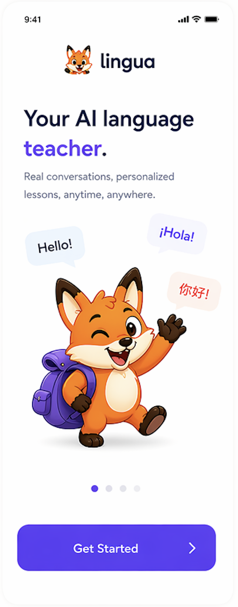
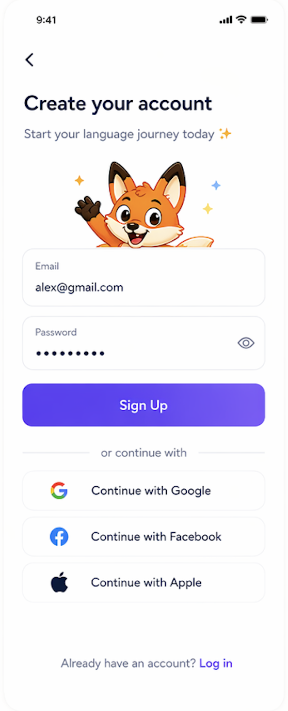
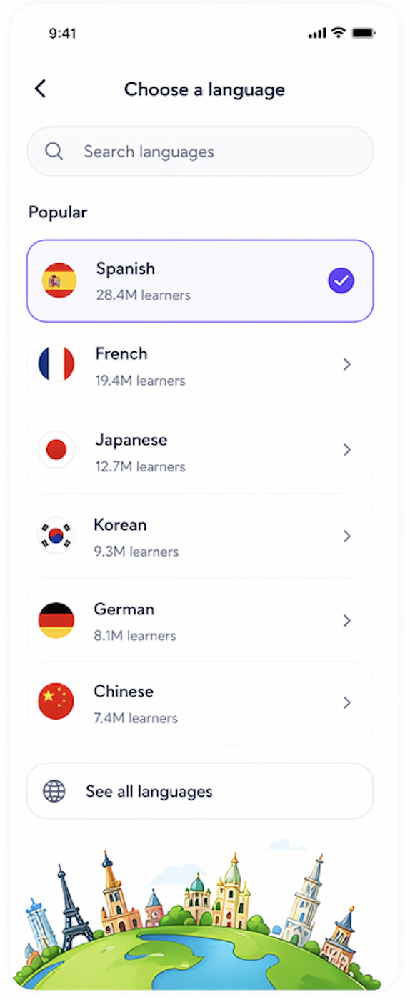
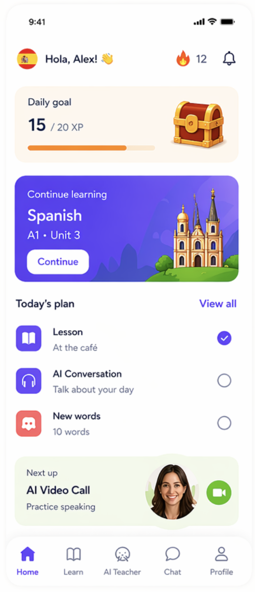
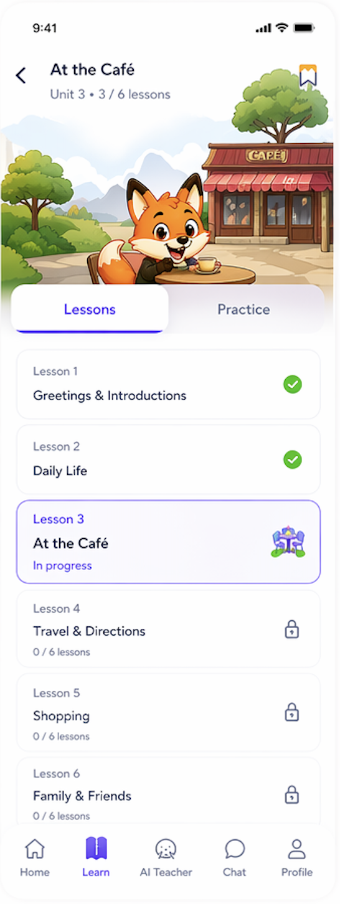
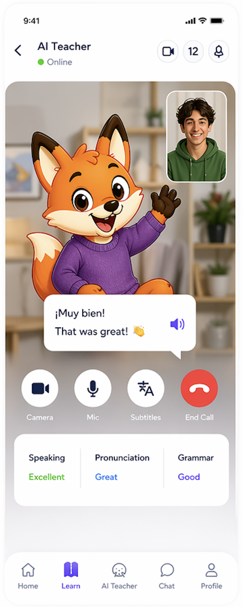
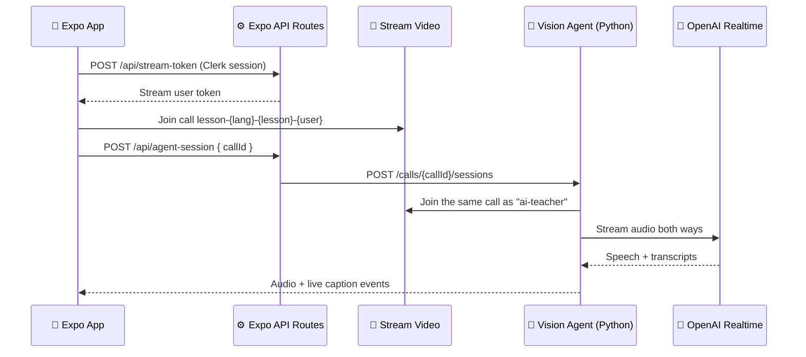

<div align="center">

# 🦉 Linguistical

**Learn a new language by actually talking to it.**

A Duolingo-inspired mobile app where an AI teacher joins you on a live voice call, listens to your pronunciation, and coaches you in real time, alongside bite-sized lessons, XP, and streaks.


</div>

---

## 📱 Screens

<table>
  <tr>
    <td align="center"><br /><b>Onboarding</b></td>
    <td align="center"><br /><b>Sign in / Sign up</b></td>
    <td align="center"><br /><b>Pick a language</b></td>
  </tr>
  <tr>
    <td align="center"><br /><b>Home & tabs</b></td>
    <td align="center"><br /><b>Lesson</b></td>
    <td align="center"><br /><b>AI voice lesson</b></td>
  </tr>
</table>

---

## 📖 Table of Contents

- [Screens](#-screens)
- [Features](#-features)
- [How the AI Teacher Works](#-how-the-ai-teacher-works)
- [Tech Stack](#-tech-stack)
- [Project Structure](#-project-structure)
- [Getting Started](#-getting-started)
- [Environment Variables](#-environment-variables)
- [Scripts](#-scripts)
- [Adding a Language or Lesson](#-adding-a-language-or-lesson)
- [Troubleshooting](#-troubleshooting)
- [Roadmap](#-roadmap)

---

## ✨ Features

| | Feature | Description |
|---|---|---|
| 🎙️ | **Live AI voice teacher** | A real-time AI tutor joins a Stream call, teaches one word at a time, and reacts to what you actually said. |
| 💬 | **Live captions** | Both your speech and the teacher's are transcribed on screen as you talk. |
| 🌍 | **6 languages** | Spanish, French, Japanese, Korean, German, and Chinese. |
| 📚 | **Structured lessons** | Units → lessons with vocabulary, phrases, multiple-choice, translate, and listening activities. |
| ⚡ | **XP & progress** | Earn XP, complete lessons, and keep your streak, all persisted locally. |
| 🔐 | **Authentication** | Email + social sign-in powered by Clerk, with email verification. |
| 🎨 | **Playful UI** | Rounded cards, soft shadows, mascots, and a custom tab bar built with NativeWind. |
| 📊 | **Product analytics** | Screen views and key events tracked with PostHog. |

---

## 🧠 How the AI Teacher Works



1. **The app never holds secrets.** It asks the Expo API route `/api/stream-token` for a Stream token, which verifies the Clerk session before signing one.
2. **The app joins a Stream call** whose ID encodes the language and lesson (for example, `lesson-es-lesson-1-user_123`).
3. **`/api/agent-session`** asks the Python Vision Agent service to join that same call.
4. **The agent** (built on [Stream Vision Agents](https://visionagents.ai)) connects to **OpenAI Realtime** and uses server-side voice activity detection, so it stops talking as soon as you start.
5. **Transcripts** flow back to the app as custom call events and render as live captions.

The system prompt keeps the teacher strict: one word at a time, never pretending you answered, and always waiting for your real reply.

---

## 🛠 Tech Stack

**Mobile app**
- [Expo 54](https://expo.dev) + [Expo Router 6](https://docs.expo.dev/router/introduction/) (file-based routing, typed routes, API routes)
- React Native 0.81 (New Architecture + React Compiler)
- TypeScript
- [NativeWind v5](https://www.nativewind.dev/) + Tailwind CSS v4
- [Zustand](https://zustand.docs.pmnd.rs/) + AsyncStorage for persisted state
- [Clerk](https://clerk.com) for authentication
- [Stream Video React Native SDK](https://getstream.io/video/) for real-time audio
- [PostHog](https://posthog.com) for analytics

**AI teacher service** (`vision-agent/`)
- Python 3.12+ with [uv](https://docs.astral.sh/uv/)
- [Vision Agents](https://visionagents.ai) (`getstream` + `openai` plugins)
- OpenAI Realtime API with `gpt-4o-mini-transcribe` for captions

---

## 📂 Project Structure

```txt
.
├── app/                     # Routes & screens (Expo Router)
│   ├── (auth)/              # sign-in, sign-up
│   ├── (tabs)/              # home, learn, ai-teacher, chat, profile
│   ├── lesson/[id].tsx      # Lesson + live AI voice session
│   ├── api/
│   │   ├── stream-token+api.ts   # Verifies Clerk JWT, signs Stream token
│   │   └── agent-session+api.ts  # Starts/stops the AI teacher session
│   ├── onboarding.tsx
│   └── language-select.tsx
├── components/              # LessonCard, TabBar, SocialButton, VerificationModal
├── constants/               # Centralized images, theme values
├── data/                    # Hardcoded, typed content: languages, units, lessons
├── store/                   # Zustand stores (language, learning progress)
├── lib/                     # External service helpers (PostHog)
├── types/                   # Shared TypeScript types
├── assets/                  # Images, mascots, fonts
├── vision-agent/            # Python AI teacher service
│   ├── main.py
│   └── pyproject.toml
├── global.css               # Tailwind + reusable BEM utilities
└── AGENTS.md                # Coding conventions for AI assistants
```

---

## 🚀 Getting Started

### Prerequisites

- **Node.js** 20+
- **Python** 3.12+ and **[uv](https://docs.astral.sh/uv/getting-started/installation/)**
- **Android Studio** and/or **Xcode** (Stream WebRTC needs a **development build**, so Expo Go won't work)
- Accounts on [Clerk](https://dashboard.clerk.com), [Stream](https://getstream.io/try-for-free/), [OpenAI](https://platform.openai.com), and optionally [PostHog](https://posthog.com)

### 1. Clone & install

```bash
git clone https://github.com/SRAYANSH-GUPTA/Linguistical.git
cd Linguistical
npm install
```

### 2. Configure environment

```bash
cp .env.example .env
```

Fill in your keys (see [Environment Variables](#-environment-variables)), then create `vision-agent/.env`:

```bash
echo "OPENAI_API_KEY=sk-..." > vision-agent/.env
```

> The Python service also reads `STREAM_API_KEY` and `STREAM_API_SECRET` from the root `.env`, so you don't have to duplicate them.

### 3. Start the AI teacher service

```bash
cd vision-agent
uv sync
uv run main.py serve
```

It listens on `http://localhost:8000` by default.

### 4. Run the app

In a second terminal, from the project root:

```bash
npx expo run:android   # or: npx expo run:ios
```

After the first native build you can just run `npx expo start` and open the installed dev build.

> **On a physical device?** Set `VISION_AGENT_URL` to your computer's LAN IP (for example, `http://192.168.1.20:8000`) so the API route can reach the agent.

---

## 🔑 Environment Variables

| Variable | Where | Description |
|---|---|---|
| `EXPO_PUBLIC_CLERK_PUBLISHABLE_KEY` | `.env` | Clerk publishable key (safe for the client). |
| `STREAM_API_KEY` | `.env` | Stream app API key. |
| `STREAM_API_SECRET` | `.env` | Stream secret. **Server only**, used by API routes and the agent. |
| `VISION_AGENT_URL` | `.env` | URL of the Python agent service. Default: `http://localhost:8000`. |
| `POSTHOG_PROJECT_TOKEN` | `.env` | PostHog project token (optional). |
| `POSTHOG_HOST` | `.env` | PostHog host, for example `https://us.i.posthog.com` (optional). |
| `OPENAI_API_KEY` | `vision-agent/.env` | OpenAI key for the Realtime API. **Never** put this in the app. |

---

## 📜 Scripts

| Command | What it does |
|---|---|
| `npm start` | Start the Expo dev server |
| `npm run android` | Build and run on Android |
| `npm run ios` | Build and run on iOS |
| `npm run web` | Run in the browser (no live AI calls) |
| `npm run lint` | Lint with ESLint (Expo config) |
| `uv run main.py serve` | Start the AI teacher service (inside `vision-agent/`) |

---

## ➕ Adding a Language or Lesson

All content is plain, typed TypeScript, with no database required.

1. **Language:** add the code to `LanguageCode` in `types/learning.ts`, then add an entry in `data/languages.ts`.
2. **Units & lessons:** add them in `data/units.ts` and `data/lessons.ts`. Each lesson defines its vocabulary, phrases, activities, XP reward, and an `aiTeacher` prompt (system prompt, intro message, topics).
3. **AI teacher voice:** add the language name to `LANGUAGE_NAMES` in `vision-agent/main.py` so the teacher knows what it's teaching.

---

## 🩺 Troubleshooting

| Problem | Fix |
|---|---|
| `Cannot reach vision agent` (503) | Make sure `uv run main.py serve` is running and `VISION_AGENT_URL` is reachable from where Metro runs. |
| Teacher joins but stays silent | Check `OPENAI_API_KEY` in `vision-agent/.env` and that your account has Realtime API access. |
| App crashes in Expo Go | Expected. WebRTC needs a dev build: `npx expo run:android` / `run:ios`. |
| `Missing required environment variable` | The agent validates `STREAM_API_KEY`, `STREAM_API_SECRET`, and `OPENAI_API_KEY` on boot. |
| Styles not applying | Clear the Metro cache: `npx expo start -c`. |

---

## 🗺 Roadmap

- [x] Onboarding, auth, and language selection
- [x] Home, learn path, and lesson activities
- [x] Live AI voice teacher with captions
- [x] XP and progress persistence
- [ ] Text-based AI chat tutor (`chat` tab)
- [ ] Profile and stats screen
- [ ] Spaced-repetition vocabulary review
- [ ] Daily goals and push reminders

---

## 🙏 Acknowledgements

- Inspired by [Duolingo](https://www.duolingo.com)
- Real-time infrastructure by [Stream](https://getstream.io) and [Vision Agents](https://visionagents.ai)
- Built as a hands-on learning project, feature by feature

<div align="center">

Made with ❤️ by [Srayansh Gupta](https://github.com/SRAYANSH-GUPTA)

⭐ Star the repo if it helped you learn something!

</div>
